<p align="center">
  
</p>

<p align="center">
  <b>A multithreaded HTTP server in C: a thread pool, a bounded buffer and pluggable scheduling.</b><br/>
  <sub>Project 3 for CYB-3053 Operating Systems Concepts at The University of Tulsa. The course provided the single-threaded server skeleton, and the concurrency, scheduling and hardening are my additions.</sub>
</p>

---

## What I built

The starting point was a single-threaded static file server. I turned it into a **producer/consumer** server:

- **Producer (main thread):** accepts a connection, parses the request, checks the file, then places it in a
  bounded buffer. It blocks on `buffer_not_full` when the buffer is full.
- **Consumers (thread pool):** `-t` worker threads block on `buffer_not_empty`, take a request, and serve it.
- **Synchronisation:** one `pthread_mutex_t` plus two condition variables guard the shared buffer.
- **Scheduling policies (`-s`):**
  - `0` **FIFO**: oldest request first
  - `1` **SFF**: shortest file first, using the file size recorded at enqueue time
  - `2` **Random**: a per-thread `rand_r` state stored in thread-specific data (`pthread_key_t`)
- **Path hardening:** every requested path is resolved with `realpath()` and must stay inside `./www`. Anything else
  gets **403 Forbidden**, which blocks `../` directory traversal.

## Usage

```bash
./wserver [-d basedir] [-p port] [-t threads] [-b buffersize] [-s schedalg]
#           default:   10000      4            64              0 (FIFO)
```

| Flag | Meaning | Default |
|---|---|---|
| `-d` | directory to serve from | current directory |
| `-p` | port | `10000` |
| `-t` | worker threads | `4` |
| `-b` | request buffer size | `64` |
| `-s` | `0` FIFO · `1` SFF · `2` Random | `0` |

> Usage and defaults are read from `src/wserver.c` and `src/request.h`. The build wasn't re-run during this README
> update because there was no POSIX toolchain on the machine used for it.

---

## Original assignment notes

### Please review the Project handout for full assignment details.

### Additional Instructions

Use the same environment you used for Project 01 and Project 02 (WSL, a Linux VM, Cygwin, other). We will not be building support for Windows.

Ensure that you obtain all files, preferably through a git clone.

Similar to Project 02, a CMakeLists.txt file and a build script have been provided for you. In the build directory, execute "./build.sh", without the quotes. If there are issues with building, ensure that you have execution permissions set (chmod +x build.sh)

### Using the files

### Server

The server must be started before any client can connect to it.

The server can be started from the build directory with "./server", without quotes. There should be no return, and it will appear as if your terminal has hung: this is normal behavior.

To change server defaults, pass "-h" while running the server ("./server -h") to see the list of options. The default port is 10000. 

### Client

For initial testing, it is recommended to utilize the client executable that is built with the build script ("./client"). After you work to complete portions of requests.c, you should be able to use any HTTP client (such as a web browser).

The client requires 3 arguments: the host, the port, and the filepath. The host will be localhost, the port by default should be 10000, and you can use any of the files in the "files" directory (ex: /files/test1.html)


